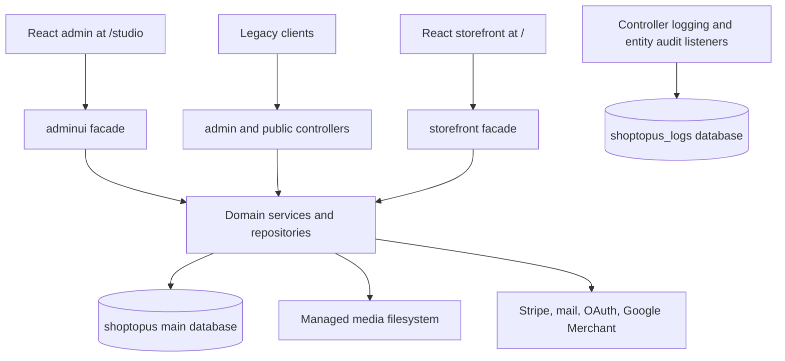

# Architecture and source map

## Scope and evidence

Baseline: `Shoptopus/shoptopus-selfhost`, commit `3f1e01322e0ff36c59473926f7d3b9523dd46602`, inspected 2026-11-05. Source paths below are relative to that repository. The checkout had no `AGENTS.md` or frontend `package.json`.

The backend has 275 Java source files (39,775 lines), 25 REST controller classes, and 40 JPA entity classes. There are 122 Java test files containing 321 `@Test` methods; these counts describe source inventory, not passed tests. Database evolution consists of 51 main migrations and three logs migrations.

The build pins Spring Boot 3.3.10, Java release 20, JJWT 0.12.6, Stripe Java 29.2.0, OpenPDF 2.0.3, springdoc 2.5.0, and Testcontainers 1.20.4. Read `pom.xml` for current versions before dependency work. The distribution includes GPLv3 licensing in `LICENSE`.

## Application shape

This is a single deployable Spring Boot application organized by domain, with distinct HTTP facades for legacy clients and React clients. It mixes Spring Data JPA with substantial PostgreSQL-specific `JdbcTemplate` SQL. There is no separate payment, logging, catalog, or messaging process in this checkout.

`CoreApplication` enables scheduling and configuration-property scanning. Constructors provide dependencies; Lombok is common on entities. Responses use both typed records and hand-built maps, so Java compilation cannot validate every JSON contract.

## Ownership map

| Package under `com.shoptopus.core` | Responsibility and starting points |
| --- | --- |
| `storefront` | Storefront-specific projections and flows: `StorefrontShopService`, `StorefrontCartService`, `StorefrontCheckoutService`, config/auth/account facades, store onboarding |
| `adminui` | React admin orchestration and projections; large `AdminUiController`; session/navigation, active-store resolution, product/page/media/reporting/settings facades |
| `admin` | Legacy admin controllers, permission checks, reusable mutations, bulk operations, AI helpers, reporting and support |
| `publicapi` | Public aliases, legacy checkout, page/content projections |
| `catalog` | Product/category/tag/attribute/option/variant entities, simpler catalog API, `CatalogMapper`, product intake |
| `cart`, `ordering`, `payment` | Shared persistence and older APIs; actual Stripe operations are in `payment/stripe/StripePaymentGateway` |
| `auth`, `social`, `user` | JWTs, database access tokens, invites/reset flows, OAuth state/handoff, accounts and owned addresses |
| `store` | Store entity/status/repository and fixed default-store resolver |
| `invoice` | Immutable-style purchase snapshots, invoice access tokens, PDF rendering |
| `page`, `content` | Page flags, content blocks, ordered menus; public projection also lives in `publicapi` |
| `files` | File metadata, polymorphic attachments, image optimization, ordered selections, cleanup aspect and paid file metadata |
| `engagement`, `messaging` | Ratings, favorites-related behavior, banners/clicks, notifications and order conversations |
| `mail`, `email` | SMTP/Gmail settings and delivery, templates, manual outgoing queue and archives |
| `logging`, `audit` | Automatic audit/event logging in the logs DB; separate legacy `audit/Audit` entity remains in the main DB |
| `backup`, `devseed`, `io` | Snapshot creation/maintenance, opt-in Laravel sample-data importer, CSV category import/export |
| `googlemerchant` | Remote Merchant API client, orchestrated by `adminui/AdminUiGoogleMerchantService` |
| `config`, `common` | Explicit persistence configuration, HTTP/security/resources, error envelope, entity base classes, translation helpers |

The admin and adminui packages account for almost half the backend source. Start with the route and smallest relevant service; loading all admin code is rarely necessary.

## Data model

| Aggregate | Important tables and relationships |
| --- | --- |
| Catalog | `products` → `product_variants`; product-category and product-tag join tables; attributes → options; variants store `attribute_options` JSON supporting several historical shapes |
| Cart | `carts` → `cart_product` (`CartItem`); an item references product, optional variant, customization value and quantity |
| Purchase | `orders` → `order_product` (`OrderItem`); order references user, address, delivery type, voucher ID and store |
| Payment | `payments` has polymorphic `payable_type`/`payable_id`, provider proof JSON, payment reference, user/store and optional payment source |
| Receipt | `invoices` stores address, user, items, totals, payment, delivery and voucher snapshot maps rather than reconstructing receipts solely from current catalog data |
| Access | `users`, `roles`, `permissions`, `model_has_roles`, `role_has_permissions`, `user_store_roles`; access tokens also support invites, receipts and OAuth handoffs |
| Content/media | `pages`, `page_menu_items`, `contents`, `file_contents`, `paid_file_contents`; polymorphic parent types and ordered attachments matter |
| Operations | stores/settings, delivery types/rules, vouchers/discounts, email archive/queue, conversations, notifications and ratings |

Do not rename persisted Laravel-style discriminator strings casually. For example, storefront payments find orders using `App\Models\Order`, and access-token fields retain the spelling `accessable_type` / `accessable_id`.

`UuidEntity` assigns missing UUIDs in `@PrePersist`. `AuditableEntity` adds timestamps and JPA listeners. `SoftDeleteEntity` only adds `deleted_at` and `isDeleted()`; it does not implement an automatic Hibernate filter. Queries commonly spell out `DeletedAtIsNull`, and JDBC queries must do the equivalent.

Translations are maps stored in PostgreSQL JSONB, with API-boundary localization through `TranslatedText.resolve`: requested language → English → first available value → empty string. Preserve translation maps on admin writes. Prices use `BigDecimal`, quantities are usually `Long`, and order-item amounts are `Integer`.

## Two database boundaries

| | Application database | Logging database |
| --- | --- | --- |
| Defaults | `shoptopus` on PostgreSQL 16 | `shoptopus_logs` on the same server |
| Configuration | `MainDataSourceConfig` | `LogsDataSourceConfig` |
| Beans | primary `mainDataSource`, `mainEntityManagerFactory`, `mainTransactionManager` | `logsDataSource`, `logsEntityManagerFactory`, `logsTransactionManager` |
| Scans | Explicit domain package lists | `com.shoptopus.core.logging` |
| Migrations | `src/main/resources/db/migration/main` | `src/main/resources/db/migration/logs` |
| History | `flyway_schema_history_main` | `flyway_schema_history_logs` |

`FlywayConfig` constructs both Flyway instances and calls `migrate()` directly. The YAML's `spring.flyway.enabled=false` does not stop these beans. `ddl-auto=validate` and `open-in-view=false` mean schema and transaction/fetch boundaries matter. Adding a new main entity package requires changing both the JPA repository scan and entity-package list.

The logs database intentionally has no cross-database foreign key to main users/stores. Do not introduce JPA relationships across persistence units or assume a single atomic transaction covers both.

Migration landmarks: V1–V2 main schema/base seed; V8 content/invoices/settings; V19–V20 known root seed password/role; V21 polymorphic files; V24 pages/content order; V30 email queue; V35 customization; V36 messaging; V39 menus; V40–V46 multistore and scoped roles/defaults; V47 footer flags; V48 favorites; V49 filterable attributes; V50 Merchant sync; V51 image dimensions. These are navigation aids; inspect the actual SQL before changing a table.

## Cross-cutting behavior

- `AuditEntityListener` captures JPA lifecycle snapshots and attempts default-store assignment for entities with a null `store` field, excluding `User` and `Store`. This fallback does not establish the requested tenant.
- Audit store attribution uses `AdminStoreContext.currentStoreIdForAuditOrNull()`, which performs scalar JDBC lookups. Calling the JPA-backed store resolver from entity lifecycle callbacks can re-enter Hibernate flush and corrupt its action queue; the logging regression exercises simultaneous dirty user/store updates and store-header permission parity.
- `AuditTrailBuffer` buffers during synchronized transactions and writes after commit through `AuditTrailWriter` in the logs transaction manager. Failures are swallowed. It is best-effort audit history, not a transactional outbox.
- `ApiLoggingAspect` wraps REST controllers and records path, query, duration, controller and failure data. It records application success/failure rather than a complete HTTP access-log model.
- JDBC mutations bypass entity listeners. For example, cart quantity update clears the entity manager after SQL to avoid stale JPA state. Audit effects must be assessed separately for SQL-heavy changes.
- `WebConfig` serves disk media at `/media/**`, classpath admin at `/studio/**`, and storefront at `/`. SPA fallback excludes API/media/studio/actuator prefixes and paths containing a dot.

`ManagedFileService` retains attachment type/parent/order, optimizes images to a maximum dimension of 1800, and records image dimensions. `ManagedFileCleanupAspect` interprets returned mutation `id` / `ids` maps for methods annotated with `@ClearManagedFiles`; changing a deletion result's shape can change cleanup behavior. Video uploads separately invoke `ffmpeg` from `AdminUiMediaService`. Filesystem writes/deletes are not rolled back with a database transaction.

## Integrations and side effects

Stripe uses a real `StripeClient` for intent creation/retrieval and refunds. Provider rows/settings exist for PayPal and Amazon, but the legacy `PaymentService.execute` only returns `accepted`; configuration presence is not proof of a complete gateway.

Mail settings (`email.gmail`, `email.smtp`) and Gmail OAuth state nonces are redacted in entity audit snapshots. Gmail OAuth callbacks use `app.api.public-base-url` / `APP_API_PUBLIC_BASE_URL`; production deployments must set the public HTTPS origin. SMTP and Gmail delivery run through `EmailSettingsService` / `EmailDeliveryService`. `ShopMailService` constructs order, receipt, message and onboarding emails. `OutgoingEmailQueueService` is a separate manual queue processor; there is no scheduler on that class. Some notifications and mail occur inside application transaction flows, so database rollback does not roll back remote effects.

Social login uses configurable providers with persisted state and one-time handoff tokens. Merchant sync uses a service-account-based API client and stores run/item state through its admin facade. Both require real provider configuration to verify end to end.

Snapshots and scheduled log purging are covered in the development reference. Their behavior has a material retention limitation documented in findings.
